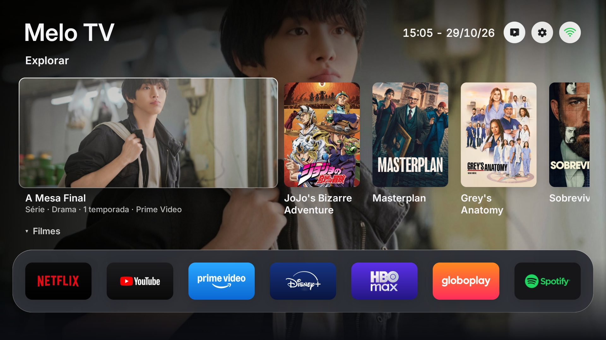
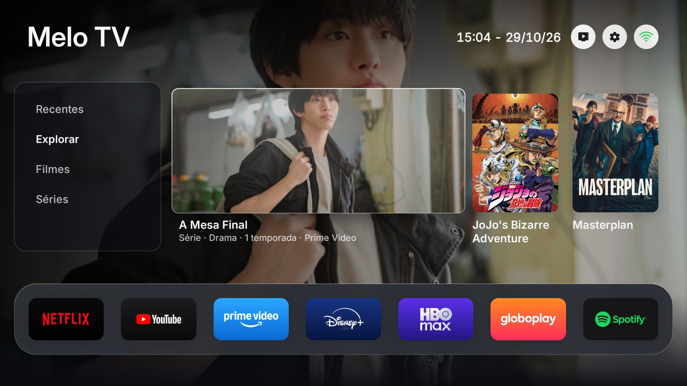
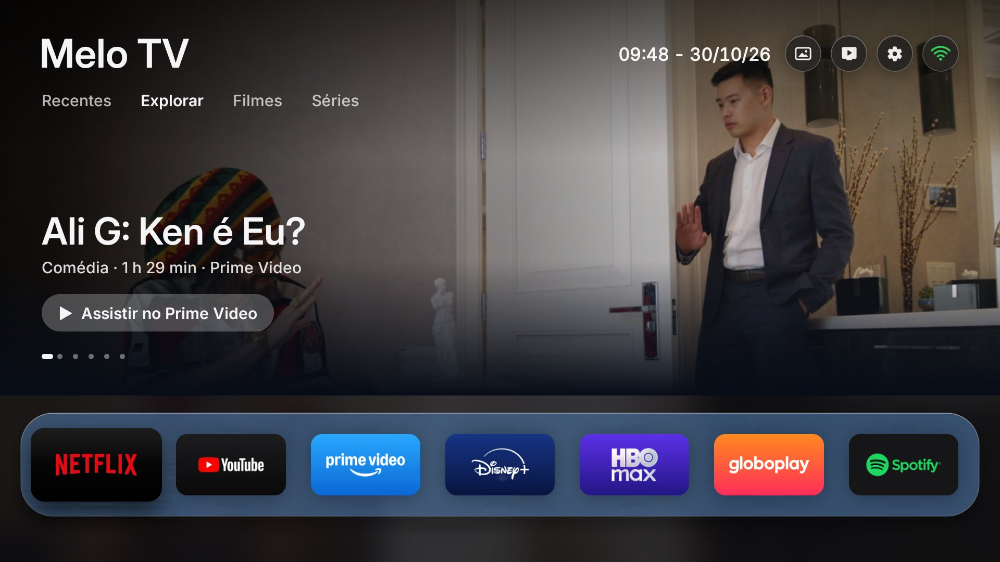

# Melo Free TV

**Tela inicial sem anúncios para Android TV e Google TV.**

[**⬇ Baixar o Melo Free TV (APK)**](https://github.com/PabloAlvesMelo/freetv/releases/latest/download/MeloFreeTV.apk)

Na TV, pelo app **Downloader**: digite o código **6272194**

Sempre a versão mais nova · [todas as versões](https://github.com/PabloAlvesMelo/freetv/releases)

## O que ele faz

- **Sem anúncios:** nada de fileiras patrocinadas, banners ou vídeos que tocam sozinhos.
- **Seus apps em primeiro lugar:** uma barra com os apps de streaming que você usa, na ordem que você escolher.
- **Destaques:** filmes e séries em alta nos apps que você já tem (Recentes, Explorar, Filmes e Séries), com a chave
  gratuita do TMDB.
- **Seis layouts:** Clássico, Cinema, Menu lateral, Minimalista, Vitrine e Menu flutuante.
- **Oito temas** (Pérola, Noite, Azul, Esmeralda, Âmbar, Índigo, Mostarda e Grafite), com o modo automático de dia e
  de noite.
- **Tela de descanso** com as fotos dos destaques ou com as suas fotos, enviadas pelo celular com um QR code.
- **Extras:** relógio e clima, câmeras ONVIF, arquivos (FX File Explorer), lista IPTV, desligamento automático e ícones de
  atalho no topo.
- **Atualiza sozinho:** procura versões novas neste repositório e instala depois de você confirmar.
- **Seguro:** não precisa de root e não desinstala nada da TV. A opção *Original* devolve a tela inicial de fábrica.

## Instalar

Você precisa de uma TV ou aparelho com Android TV ou Google TV (Android 8 ou mais novo). Testado no Xiaomi Mi TV Stick.

### 1. Ative a depuração USB na TV

Em **Configurações > Preferências do dispositivo > Sobre**, clique 7 vezes em **Build** (ou *Versão do Android TV OS*).
Depois, em **Opções do desenvolvedor**, ative a **Depuração USB**.

Ela é necessária porque o Melo Free TV usa o ADB da própria TV para trocar a tela inicial de fábrica pela dele. Não
precisa de computador.

### 2. Instale o APK pelo Downloader

1. Na Play Store da TV, instale o app **Downloader** (da AFTVnews).
2. Abra o Downloader, digite o código **6272194** e aperte *Go*. Ele baixa a versão mais nova do Melo Free TV.
3. Se a TV pedir, permita que o Downloader instale apps (*Configurações > Apps > Segurança e restrições > Fontes
   desconhecidas*, ligue o Downloader) e volte para ele.
4. Confirme a instalação. Se o Google Play Protect avisar, escolha *Mais detalhes > Instalar mesmo assim*.

O código leva a `https://github.com/PabloAlvesMelo/freetv/releases/latest/download/MeloFreeTV.apk`: se preferir,
digite esse endereço no Downloader.

### 3. Ative na TV

Abra o **Melo Free TV**, vá em **Início** e escolha **Melo Free TV**. A TV pergunta *Permitir depuração USB?*: marque
*Sempre permitir* e confirme. Em alguns segundos a tela inicial nova aparece.

Se a troca parar pedindo para esquecer a rede Wi-Fi, é porque ela foi salva na configuração inicial da TV: em
*Configurações > Rede e Internet*, esqueça a rede, conecte de novo e repita a troca.

Para ver os destaques, coloque a sua chave gratuita do TMDB em **Adicionais > Chave do TMDB** (pelo celular, com o
QR code, ou digitando com o controle).

Para conseguir a chave do TMDB (grátis, leva uns dois minutos):

1. Crie uma conta em [themoviedb.org](https://www.themoviedb.org/signup) e confirme o e-mail.
2. Entre na conta e abra **Configurações > API** ([themoviedb.org/settings/api](https://www.themoviedb.org/settings/api)).
3. Peça uma chave de desenvolvedor (*Developer*), para uso pessoal, aceite os termos e preencha o formulário. Pode
   descrever o uso como "tela inicial da minha TV".
4. Copie a **Chave da API** (*API Key*) ou o **Token de leitura da API** (*API Read Access Token*): qualquer um dos
   dois serve. No celular, é só colar na página que abre pelo QR code.

A chave é sua: não a compartilhe.

### 4. Confira as Configurações

Para liberar memória (em aparelhos de 1 GB, como o Mi TV Stick, cada MB conta), três itens vêm **desligados**:

- **Assistente de voz:** o botão do microfone do controle não faz nada.
- **Chromecast embutido:** a TV não aparece para transmitir do celular.
- **Sons de navegação:** sem cliques ao mexer no controle.

Se precisar de algum deles, ligue em **Melo Free TV > Configurações**. A escolha fica gravada e vale também depois de
atualizações e reinícios. Voltar para *Original* em **Início** liga o Chromecast de novo; o assistente de voz segue a
opção, então ligue-o antes se for voltar para o *Original* ou desinstalar.

Vale a pena olhar esse menu logo depois de instalar: ali também ficam o título da tela, o idioma, a temperatura, os
destaques e a tela de descanso.

### Última alternativa: instalar pela depuração USB, com um computador

Só se a instalação pelo Downloader (passo 2) não der certo. Você vai precisar de um computador com o
[ADB](https://developer.android.com/tools/releases/platform-tools) (Android SDK Platform-Tools):

1. Ative a depuração USB (passo 1) e ligue a TV ao computador pelo cabo USB. Sem cabo, pela rede: veja o IP da TV em
   *Configurações > Rede e Internet* e rode `adb connect <IP da TV>:5555`.
2. A TV pergunta *Permitir depuração USB?*: marque *Sempre permitir* e confirme. `adb devices` deve listar a TV.
3. Baixe o [APK](https://github.com/PabloAlvesMelo/freetv/releases/latest/download/MeloFreeTV.apk) e instale com
   `adb install -r MeloFreeTV.apk`. Se o comando parar, olhe a TV: o Google Play Protect pode estar perguntando
   (*Mais detalhes > Instalar mesmo assim*).
4. Rode `adb disconnect` (ou tire o cabo) e siga o passo 3 na TV. A troca de tela inicial é feita pela própria TV,
   não pelo computador.

## Antes de desinstalar

**Volte para a tela original antes de desinstalar:** **Início > Original**. Se o app for desinstalado no modo Melo
Free TV, a TV fica sem tela inicial e o aparelho pode ficar inutilizado. Não nos responsabilizamos por danos causados
por desinstalar o app sem esse cuidado.

Se for usar o assistente de voz depois, ligue-o antes em **Configurações > Assistente de voz**: o *Original* traz de
volta a tela inicial, os apps e o Chromecast, mas o assistente segue essa opção.

## Doação

Se você gostou do Melo Free TV, pode ajudar com um Pix de qualquer valor: em **Doação**, no fim das configurações do
app, há um QR code. Obrigado!

## Compilar

> **Esta parte é para quem conhece programação.** Para usar o Melo Free TV, basta instalar o APK pronto (veja
> [Instalar](#instalar)): não é preciso compilar nada. Compilar exige usar o terminal, instalar ferramentas de
> desenvolvimento Android e editar arquivos de configuração. Se você não tem essa experiência, use um assistente de
> IA para ajudar (veja [Com ajuda de IA](#com-ajuda-de-ia), abaixo).

### Por que compilar

- Para ter os recursos que a versão publicada não tem: o widget *Tocando agora* e os botões do controle dentro de
  outros apps (TCL, Sony, Hisense e outras). Eles usam acesso às notificações e acessibilidade, e o Google Play
  Protect bloqueia a instalação pelo Downloader de apps que pedem isso. Compilado e instalado pelo `adb`, o app tem
  os dois.
- Para já deixar no app a sua cidade, a sua chave do TMDB e outras preferências.
- Para mudar o código.

### O que você precisa

- **JDK 17** ou mais novo (`java -version`).
- **Android SDK** com as ferramentas de linha de comando: *build-tools 34* e *android-34*
  (`sdkmanager "build-tools;34.0.0" "platforms;android-34"`).
- **ADB** (Android SDK Platform-Tools), para instalar na TV.
- **Bash:** no macOS e no Linux já vem; no Windows, use o Git Bash ou o WSL. No Git Bash, defina o `ANDROID_HOME`
  no formato do Windows (`C:\Users\<você>\AppData\Local\Android\Sdk`), não no formato `/c/Users/...`.

Não usa Gradle nem bibliotecas: o `build.sh` chama direto as ferramentas do SDK.

### Passo a passo

1. Rode `./build.sh` uma vez: ele cria o `config.properties` a partir do `config.example.properties`.
2. Edite o `config.properties`: `latitude`, `longitude` e `city` da sua cidade, `tmdb_region` (país, duas letras,
   como `BR`), `currency`, `temperature` e, se quiser, a sua `tmdb_key`. Esse arquivo não vai para o repositório:
   nunca o publique, porque ele guarda as suas chaves.
3. Rode `./build.sh` de novo. Ele deve terminar com `Built FreeMyTV.apk`.
4. Instale na TV com `adb install -r FreeMyTV.apk` (veja a última alternativa em [Instalar](#instalar)).

Na primeira vez, o `build.sh` cria a chave de assinatura `freemytv.keystore`. Guarde-a: as atualizações precisam ser
assinadas com a mesma chave, senão o Android recusa. Por isso, um APK compilado por você não instala por cima da
versão publicada: antes, volte para **Início > Original** e desinstale a publicada.

Antes de enviar mudanças, rode `tools/check.sh`: ele compila o app e confere as traduções, como o GitHub faz em
cada pull request.

A versão publicada, sem chave nem cidade (a cidade vem do fuso horário da TV), sai de `./build.sh --generic`.

### Com ajuda de IA

O projeto traz um guia para assistentes de IA: o [CLAUDE.md](CLAUDE.md) (e o [AGENTS.md](AGENTS.md), para os
outros). Com um assistente que trabalha no seu computador, como o [Claude Code](https://claude.com/claude-code), dá
para pedir em português, por exemplo: *"Compile o Melo Free TV e instale na minha TV, no IP 192.168.1.50. Moro em
São Paulo."* Ele confere as ferramentas, instala o que faltar, explica cada passo e pede a sua confirmação antes de
mexer na TV.

Mesmo com a IA, leia o que ela vai fazer antes de confirmar e nunca cole a sua chave do TMDB no chat: coloque-a você
mesmo no `config.properties`.

## Lista IPTV

`tv/lista.m3u` traz canais abertos e gratuitos, com o guia (EPG) no cabeçalho. Para editar, use `tv/canais.txt` e
rode `python tv/montar.py`.

Para assistir, use o **TiviMate** (Play Store), que o bloco *TV online* da tela inicial abre. Na TV, **Adicionais >
Lista IPTV** baixa a lista para a pasta Download; no TiviMate, escolha *Adicionar playlist > M3U > Selecionar playlist
local*. O TiviMate é gratuito e tem uma versão paga, o **TiviMate Premium**, com mais recursos (por exemplo, várias
listas, gravação e favoritos). A versão gratuita basta para esta lista.

## Créditos

O Melo Free TV é baseado no [Free My TV](https://github.com/simbasjungles/free-my-tv), de simbasjungles, sob a
licença MIT (veja [LICENSE](LICENSE)). O projeto original também tem versões para TVs LG (webOS) e Samsung (Tizen).
